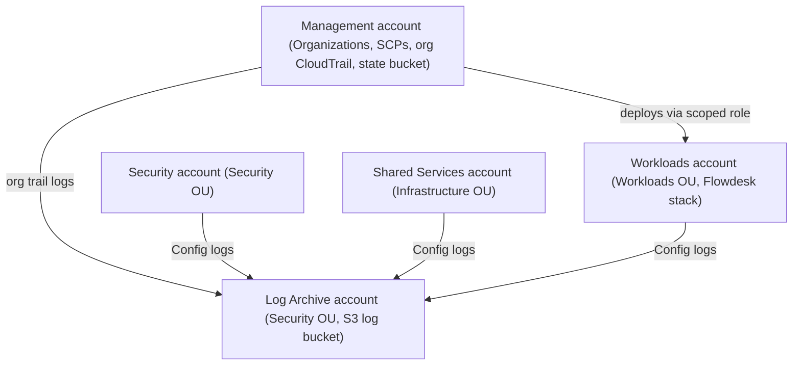

# Flowdesk Landing Zone

A governed multi-account AWS foundation for Flowdesk, built entirely with Terraform. The original single-account Flowdesk stack was refactored into a reusable module and deployed into a dedicated Workloads account, inside an AWS Organization with codified guardrails (Service Control Policies), organization-wide CloudTrail, AWS Config in every account, and a least-privilege deployment role.

**Stack:** AWS Organizations, SCPs, CloudTrail, AWS Config, IAM, S3, Terraform (S3 remote state with native locking), GitHub (PR-only changes to `main`).

## The problem

Flowdesk was built and proven in a single AWS account with a personal admin identity: no account boundary between environments, no organization-wide guardrails, and no audit trail that survives a compromised account. That works for a demo and becomes a liability at scale.

## The solution

A 5-account AWS Organization where the account boundary is the blast-radius boundary, guardrails are code, and logs are written somewhere the workload account cannot erase.



| Account | OU | Purpose |
|---|---|---|
| Management | Root | Organizations, SCPs, organization CloudTrail, Terraform state bucket. No workloads. |
| Security | Security | Reserved for security tooling. Currently holds only its AWS Config recorder. |
| Log Archive | Security | Central, deletion-protected S3 bucket for CloudTrail and Config logs. |
| Shared Services | Infrastructure | Reserved for shared tooling. Currently holds only its AWS Config recorder. |
| Workloads | Workloads | Flowdesk: VPC, ALB, Auto Scaling Group, RDS, S3 static site, CloudWatch. |

The reasoning, including the alternatives rejected (single account, account-per-environment, AWS Control Tower), is in [ADR 0001](docs/adr/0001-account-structure.md).

## Guardrails (Service Control Policies)

Six SCPs, defined in `organization/scps.tf` and attached to the Workloads OU:

| SCP | What it prevents |
|---|---|
| `flowdesk-deny-root-user` | Any action by the root user of a member account |
| `flowdesk-restrict-regions` | Activity outside eu-west-1, eu-central-1 and us-east-1 (global services exempt) |
| `flowdesk-protect-logging` | Stopping, deleting or modifying CloudTrail and AWS Config |
| `flowdesk-deny-leave-org` | Leaving the organization |
| `flowdesk-require-encryption` | Creating unencrypted RDS instances and EBS volumes, or uploading S3 objects with an invalid encryption header |
| `flowdesk-deny-public-s3` | Changing S3 Block Public Access settings, bucket policies or bucket ACLs |

SCPs never apply to the management account, so all validation was run from the Workloads account.

## Centralized logging

- One organization-wide, multi-region CloudTrail with log file validation, delivering to the Log Archive account.
- The log bucket policy denies `DeleteObject`, `DeleteObjectVersion`, `DeleteBucket` and `DeleteBucketPolicy` to everyone, enforces TLS, and blocks public access.
- An AWS Config recorder and delivery channel in all five accounts, writing to the same bucket.

## Flowdesk, refactored

The original Terraform (six modules: network, security, storage, compute, database, monitoring) now lives in `modules/flowdesk/` as a reusable module with no provider block of its own. It is deployed from `workloads/flowdesk-prod/`, whose provider assumes a role in the Workloads account instead of using a personal admin identity.

Deploying it into the governed account exposed code that the guardrails correctly rejected or that needed changing:

| Finding | Fix |
|---|---|
| RDS created without `storage_encrypted` was denied by the encryption SCP | Added `storage_encrypted = true` |
| Explicit S3 Block Public Access resource conflicts with the public-S3 SCP | Removed it. New buckets have Block Public Access on by default and the SCP prevents anyone turning it off |
| Launch template had no encrypted root volume | Added an encrypted gp3 root volume (30 GB, the minimum for the AL2023 image) and required IMDSv2 |
| Hardcoded EC2 key pair | Made optional. Instances are in private subnets with no SSH |
| Windows line endings corrupted the user data script | Strip carriage returns in Terraform before encoding |

## Least-privilege deployer role

Flowdesk is deployed through `flowdesk-terraform-deployer` in the Workloads account, not through `OrganizationAccountAccessRole` (effectively administrator). Defined in `iam/main.tf`:

- Trust is limited to the management-account Terraform user.
- EC2, ELB, Auto Scaling, RDS, CloudWatch and S3 are allowed in eu-west-1 only.
- IAM is limited to `flowdesk-*` roles and instance profiles, and the only managed policy it can attach is `AmazonS3ReadOnlyAccess`. `PassRole` is limited to EC2.
- KMS is usable only through RDS and EC2.
- An explicit deny blocks creating IAM users or access keys, and using Organizations, CloudTrail and Config.
- An explicit deny stops the role editing itself, which prevents privilege escalation.

The full Flowdesk stack (35 resources) was created and destroyed through this role.

## Validation

Guardrails were tested by attempting the forbidden actions from the Workloads account. Results and notes, including a mistake I made by testing from the wrong account first, are in [docs/guardrail-validation.md](docs/guardrail-validation.md).

## Repository layout

```
bootstrap/        Terraform state bucket (S3, versioned, encrypted, TLS-only)
organization/     Organization, OUs, member accounts, SCPs
logging/          Log Archive bucket and organization CloudTrail
config/           AWS Config recorders in all five accounts
iam/              Least-privilege Terraform deployer role (Workloads account)
modules/
  config-recorder/  Reusable Config recorder
  flowdesk/         Flowdesk VPC/ALB/ASG/RDS/S3/monitoring module
workloads/
  flowdesk-prod/    Deploys the module into the Workloads account
docs/             ADR, runbook, validation results, screenshots
```

All changes to `main` go through pull requests (enforced by a GitHub ruleset).

## Cost

Organizations, SCPs and IAM are free. The first copy of management events in CloudTrail is free. The Flowdesk stack (ALB, two small instances, one small RDS instance, no NAT Gateway) cost roughly $0.15 per hour and was destroyed after testing. The organization, logging, config and iam stacks were left in place.

## Known limitations and next steps

- The deployer role is scoped by service, not by individual action (for example `ec2:*` limited to eu-west-1). Tightening it to an action-by-action list, for instance from CloudTrail data, is the next step. The role itself was created through `OrganizationAccountAccessRole`, which remains available for break-glass use.
- SCPs are attached to the Workloads OU only. Extending them to the Security and Infrastructure OUs is planned.
- The deny-root SCP is codified and attached but not tested, because testing requires signing in as the member account's root user.
- The Security and Shared Services accounts are provisioned but empty. A Config aggregator and security tooling would live in Security.
- The Terraform state bucket lives in the management account. A production setup would move it to a dedicated account.
- Dev, staging and prod are not yet separate accounts. The Workloads OU is designed to hold them.

## Runbook

How to onboard a new workload account: [docs/runbook-onboard-workload-account.md](docs/runbook-onboard-workload-account.md).

