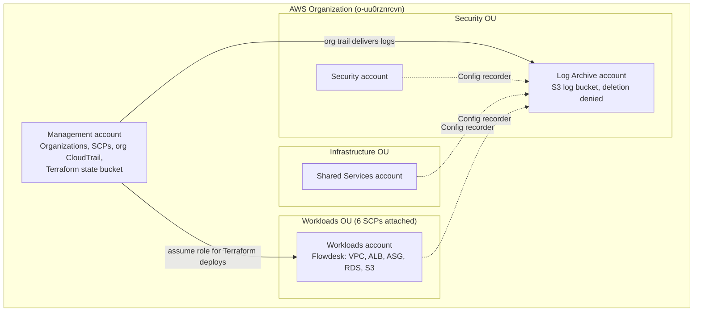

# Flowdesk Landing Zone

A governed multi-account AWS foundation for Flowdesk, built entirely with Terraform. The original single-account Flowdesk stack was refactored into a reusable module and deployed into a dedicated Workloads account, inside an AWS Organization with codified guardrails (Service Control Policies), organization-wide CloudTrail, and AWS Config in every account.

**Stack:** AWS Organizations, SCPs, CloudTrail, AWS Config, IAM, S3, Terraform (S3 remote state with native locking), GitHub (PR-only changes to `main`).

## The problem

Flowdesk was built and proven in a single AWS account with a personal admin identity: no account boundary between environments, no organization-wide guardrails, and no audit trail that survives a compromised account. That works for a demo and becomes a liability at scale.

## The solution

A 5-account AWS Organization where the account boundary is the blast-radius boundary, guardrails are code, and logs are written somewhere the workload account cannot erase.

| Account | OU | Purpose |
|---|---|---|
| Management | Root | Organizations, SCPs, organization CloudTrail, Terraform state bucket. No workloads. |
| Security | Security | Reserved for security tooling. Currently holds only its AWS Config recorder. |
| Log Archive | Security | Central, deletion-protected S3 bucket for CloudTrail and Config logs. |
| Shared Services | Infrastructure | Reserved for shared tooling. Currently holds only its AWS Config recorder. |
| Workloads | Workloads | Flowdesk: VPC, ALB, Auto Scaling Group, RDS, S3 static site, CloudWatch. |

The reasoning, including the alternatives rejected (single account, account-per-environment, AWS Control Tower), is in [ADR 0001](docs/adr/0001-account-structure.md).

## Guardrails (Service Control Policies)

Six SCPs, defined in `organization/scps.tf` and attached to the Workloads OU:

| SCP | What it prevents |
|---|---|
| `flowdesk-deny-root-user` | Any action by the root user of a member account |
| `flowdesk-restrict-regions` | Activity outside eu-west-1, eu-central-1 and us-east-1 (global services exempt) |
| `flowdesk-protect-logging` | Stopping, deleting or modifying CloudTrail and AWS Config |
| `flowdesk-deny-leave-org` | Leaving the organization |
| `flowdesk-require-encryption` | Creating unencrypted RDS instances and EBS volumes, or uploading S3 objects with an invalid encryption header |
| `flowdesk-deny-public-s3` | Changing S3 Block Public Access settings, bucket policies or bucket ACLs |

SCPs never apply to the management account, so all validation was run from the Workloads account.

## Centralized logging

- One organization-wide, multi-region CloudTrail with log file validation, delivering to the Log Archive account.
- The log bucket policy denies `DeleteObject`, `DeleteObjectVersion`, `DeleteBucket` and `DeleteBucketPolicy` to everyone, enforces TLS, and blocks public access.
- An AWS Config recorder and delivery channel in all five accounts, writing to the same bucket.

## Flowdesk, refactored

The original Terraform (six modules: network, security, storage, compute, database, monitoring) now lives in `modules/flowdesk/` as a reusable module with no provider block of its own. It is deployed from `workloads/flowdesk-prod/`, whose provider assumes a role in the Workloads account instead of using a personal admin identity.

Deploying it into the governed account exposed code that the guardrails correctly rejected or that needed changing:

| Finding | Fix |
|---|---|
| RDS created without `storage_encrypted` was denied by the encryption SCP | Added `storage_encrypted = true` |
| Explicit S3 Block Public Access resource conflicts with the public-S3 SCP | Removed it. New buckets have Block Public Access on by default and the SCP prevents anyone turning it off |
| Launch template had no encrypted root volume | Added an encrypted gp3 root volume (30 GB, the minimum for the AL2023 image) and required IMDSv2 |
| Hardcoded EC2 key pair | Made optional. Instances are in private subnets with no SSH |
| Windows line endings corrupted the user data script | Strip carriage returns in Terraform before encoding |

## Validation

Guardrails were tested by attempting the forbidden actions from the Workloads account. Results and notes, including a mistake I made by testing from the wrong account first, are in [docs/guardrail-validation.md](docs/guardrail-validation.md).

## Repository layout
@'
# Runbook: Onboard a New Workload Account

Worked example: Flowdesk, which was onboarded as the `workloads` account. To onboard a new account, repeat these steps with a new name (for example `analytics`).

Every change goes through a pull request. Never push to `main`.

## Before you start

- You have management-account credentials and Terraform 1.10 or newer.
- You have a unique email address for the new account (Gmail plus-addressing works).
- You have checked Service Quotas for the maximum number of accounts in the organization.
- Your credentials are loaded in the current terminal:
  `aws configure export-credentials --format powershell | Invoke-Expression`

## 1. Create the account

1. Create a branch: `git checkout -b feat/onboard-<name>`
2. In `organization/terraform.tfvars` (gitignored), add the new email to the `emails` map.
3. In `organization/main.tf`, add the account to `local.accounts`:
   `analytics = { name = "flowdesk-analytics", ou = "Workloads" }`
4. If the account needs a new OU, add it to `local.ous`.
5. Run `terraform plan` in `organization/` and confirm only the new account is added.
6. Run `terraform apply`. Account creation takes 5 to 10 minutes.

The account inherits every SCP attached to its OU automatically, so it is governed from its first minute.

Note: accounts created with `close_on_deletion = true` are closed if the resource is destroyed. Never run `terraform destroy` in `organization/`.

## 2. Turn on AWS Config

1. In `config/main.tf`, add a provider alias that assumes `OrganizationAccountAccessRole` in the new account, following the existing pattern.
2. Add a `module "config_<name>"` block that calls `../modules/config-recorder` with that provider.
3. Run `terraform plan` and `terraform apply` in `config/`.
4. Verify with `aws configservice describe-configuration-recorder-status --profile <name>` that `recording` is `true`.

CloudTrail needs no change. The organization trail covers every new account automatically, and the log bucket policy already allows its writes.

## 3. Add a deployment stack

1. Copy `workloads/flowdesk-prod/` to `workloads/<name>/`.
2. Change the state key to `workloads/<name>/terraform.tfstate`.
3. Change the account lookup to the new account's key in the organization outputs.
4. Replace the module call with the module for the new workload.
5. Run `terraform init`, `terraform plan`, and `terraform apply`.

## 4. Validate the guardrails

Add an AWS CLI profile for the new account in `~/.aws/config`, then confirm you are really in it:

`aws sts get-caller-identity --profile <name>`

The Account field must be the new account's ID. Then attempt the forbidden actions and confirm each is denied (see `docs/guardrail-validation.md`):

- Stop the Config recorder
- Disable S3 Block Public Access on a bucket
- Create resources in a non-approved region
- Create an unencrypted EBS volume
- Leave the organization

Never run these from the management account. SCPs do not apply there, so the actions will succeed.

## 5. Merge and record

1. Commit, push the branch, open a pull request and squash-merge it.
2. Add screenshots of the new account in the console to `docs/screenshots/`.

## Rollback

To remove a workload, run `terraform destroy` only in that workload's stack (`workloads/<name>/`). Do not destroy `organization/`, `logging/` or `config/`. The log bucket cannot be deleted by design.
